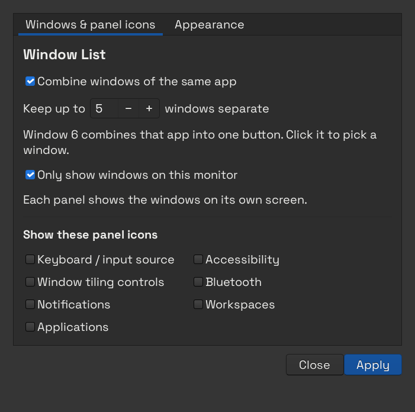
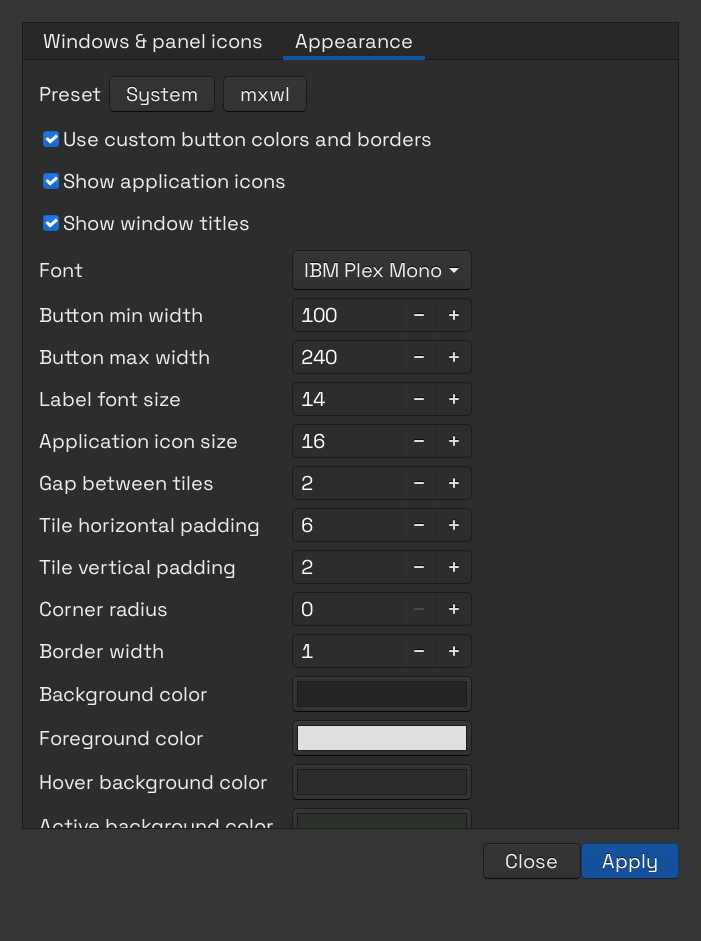
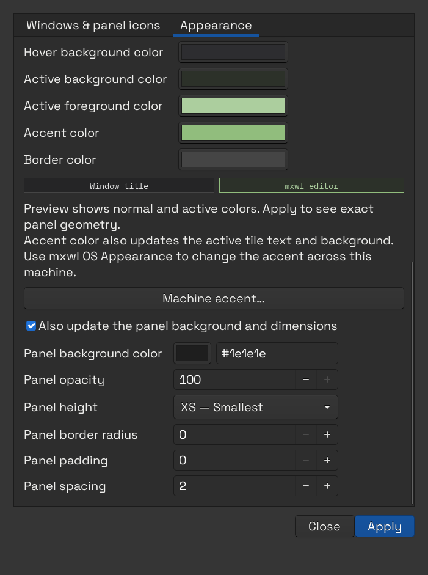

# COSMIC Window List

A taskbar-style window list for the COSMIC desktop: individual window buttons,
optional grouping, and a separate view of the windows on each monitor.

Built for people who want to see and switch between their windows directly.

## Features

- **Window titles and icons.** Each window gets an icon and its live title,
  including animated terminal spinners.
- **Adjustable grouping.** Keep up to five windows of an app separate; the sixth
  combines them into a counted button. Change the threshold or turn grouping off.
- **Window picker.** Click a combined button to select or close an individual window.
- **Per-monitor panels.** Each panel shows windows on its own monitor by default.
  Group counts are calculated after filtering for that monitor.
- **Familiar controls.** Click to focus or restore; click the active window to
  minimize it. Middle-click an individual button to close that window.
- **Overflow scrolling.** Use the mouse wheel when the window list gets crowded.
- **Panel icon settings.** Show or hide input source, accessibility, tiling,
  Bluetooth, notifications, Workspaces, and Applications buttons.
- **Appearance controls.** Choose button and hover colors, active colors, borders,
  corner radius, font, icon size, widths, padding and spacing. Preview normal and
  active colors, choose the **mxwl** preset, or return to **System** styling.
- **Panel appearance.** Optionally change the panel background, opacity, size,
  corner radius, padding and spacing without rearranging its applets.

Right-click a window button to open **Window List Settings**. You can also find
it by name in the COSMIC launcher. Settings apply immediately and survive restarts.

## Screenshots

The running panel with the **mxwl** preset and four editable accent colors.
The highlighted mxwl-editor window is active; Projects and Terminal are inactive.
These are cropped screenshots of the applet on a COSMIC panel.

| Accent | Running panel |
| --- | --- |
| Green |  |
| Sky |  |
| Lavender |  |
| Peach |  |

Choose **mxwl** in **Settings → Appearance**, then edit **Accent color** to
reproduce these variations. Active text and background colors are derived from
the accent and can also be adjusted independently.

**Windows and panel icons.** Control grouping, its window-count threshold,
per-monitor filtering and which COSMIC panel buttons are visible.



<details>
<summary>Appearance: presets, fonts and tile dimensions</summary>

Choose System or mxwl styling, show icons and titles, select a font, and adjust
button widths, label and icon sizes, spacing, padding, borders and corners.



</details>

<details>
<summary>Appearance: tile colors, preview and optional panel styling</summary>

Edit normal and active colors, inspect their preview, and optionally apply a
panel background, opacity, height, corner radius, padding and spacing.



</details>

## Compatibility

Tested on **Pop!_OS 24.04 with COSMIC and Wayland**, on two monitors with different
scaling settings. This is a COSMIC panel applet; GNOME extensions are not required.

The applet builds from System76's `cosmic-app-list` at the pinned revision
[`63292ab`](https://github.com/pop-os/cosmic-applets/commit/63292ab74dc8ef9c8d4e04055047c7671554e937),
corresponding to `cosmic-applets` 1.0.15. It installs as a separate, user-local applet.
Other COSMIC versions may need compatibility changes.

## Install

Run these commands as your normal user. Only the system dependency step uses
`sudo`. Run the panel activation steps from a terminal in your COSMIC session.

### 1. Install build dependencies

On Pop!_OS 24.04:

```sh
sudo apt update
sudo apt install \
  build-essential pkg-config git curl python3 python3-gi gir1.2-gtk-3.0 \
  libxkbcommon-dev libwayland-dev libfontconfig-dev libfreetype-dev \
  libdbus-1-dev libudev-dev
```

### 2. Install Rust

A current stable Rust toolchain is required. If you already have one, skip this
step. The verified build used Rust 1.99.1.

```sh
curl --proto '=https' --tlsv1.2 -sSf https://sh.rustup.rs -o /tmp/cosmic-window-list-rustup.sh
sh /tmp/cosmic-window-list-rustup.sh -y --profile minimal
. "$HOME/.cargo/env"
```

### 3. Clone and build

```sh
git clone https://github.com/KerryRitter/cosmic-window-list.git
cd cosmic-window-list
bash build.sh
```

This repository is public; GitHub authentication is not required. You can also
clone it with `gh repo clone KerryRitter/cosmic-window-list`.

The first build downloads the pinned upstream source and Cargo dependencies into
`upstream/` and compiles a release executable. This can take several minutes.

### 4. Install and add the applet

The manual activation option works with a fresh COSMIC panel:

```sh
python3 install.py --no-enable
```

Then:

1. Open **COSMIC Settings → Desktop → Panel**.
2. Add **Window List** in the panel's applet editor.
3. Remove **App Tray** from that panel if it is already present.
4. If you want a single taskbar, disable the separate dock in **Desktop → Dock**.

`--no-enable` installs the applet and its settings application without changing
your panel layout or icon visibility. If the new applet is not listed immediately,
close and reopen COSMIC Settings, or log out and back in.

### Automatic activation for an existing App Tray

If your panel already contains **App Tray**, you can install and replace it directly:

```sh
python3 install.py
```

This backs up the panel configuration and replaces App Tray in its existing slot.
On the first automatic installation it also hides these panel buttons:

- Keyboard/input source, Accessibility, Window tiling controls
- Bluetooth and Notifications
- Workspaces and Applications

Use **Window List Settings** to bring any of them back. Subsequent installations
preserve your choices. The installer does not change panel position or enable a dock.

## Settings and behavior

| Setting | Default | Behavior |
| --- | --- | --- |
| Combine windows of the same app | On | Combines an app when its visible window count exceeds the threshold |
| Keep up to … windows separate | 5 | Windows 1–5 stay separate; window 6 combines that app |
| Only show windows on this monitor | On | Windows appear on the panel of the monitor where they are open |
| Panel icon checkboxes | Current panel layout | Toggle individual COSMIC panel buttons |

For example, with monitor filtering enabled, three Chrome windows on each of two
monitors remain separate. Six Chrome windows on one monitor combine on that
monitor's panel. Moving a window between monitors updates the corresponding lists.

Minimized windows remain available on their monitor's panel. A window spanning
multiple monitors can appear on each monitor it occupies.

Right-click an individual or combined button for settings. With no open windows,
right-click **No windows**.

### Appearance

Open **Window List Settings → Appearance**. The **mxwl** preset uses the editor's
charcoal surfaces, green active border, square corners and IBM Plex Mono labels.
Its colors and dimensions remain editable. Choose **Apply** to save; running
applets update immediately. **System** restores the default button appearance.
Keep icons, titles, or both visible. Group counts remain visible with icons alone.

Panel changes are optional: enable **Also update the panel background and
dimensions** before applying those fields. Panel background accepts `#rrggbb` or
`ThemeDefault`; panel opacity is a percentage. These controls affect the panel
named `Panel` on its configured outputs.

Use **Background color** and **Foreground color** for normal window tiles, and
**Active background color** and **Active foreground color** for the focused
window. **Panel background color** has a color picker as well as hex input.

The fonts are installed by the companion
[`mxwldev/mxwl-os`](https://github.com/mxwldev/mxwl-os) project. Fonts fall back
to an available system font if they are not installed. The applet works with
your current desktop theme independently of that project.

The compact mxwl preset uses 14 px labels, 6 px horizontal and 2 px vertical tile
padding and 2 px gaps. Optional panel settings use the smallest (XS) height with
zero outer padding. All these values are editable in **Appearance**.
Choosing **Accent color** automatically derives the active tile background and
text color; you can then adjust those independently. **Machine accent…** opens
the companion mxwl OS Appearance settings, when installed, for desktop-wide
colors, fonts and window appearance.

Command-line equivalents:

```sh
python3 settings.py --show
python3 settings.py --preset mxwl
python3 settings.py --preset mxwl --panel
python3 settings.py --preset system
```

Existing grouping, monitor filtering, favorites and panel applets survive preset
changes. Backups are saved under `~/.local/state/cosmic-backups/` before writes.

## Update

From the cloned repository:

```sh
git pull --ff-only
bash build.sh
python3 install.py
```

For an installation you manage through the panel editor, use
`python3 install.py --no-enable` instead, then remove and re-add the applet to load
the rebuilt binary.

Edit the files in this repository to change the applet. `upstream/` is a generated
build workspace: `prepare.py` regenerates the modified upstream files on each build.

## Installed files

Everything installs under your home directory:

| Location | Contents |
| --- | --- |
| `~/.local/bin/cosmic-window-list` | Applet executable |
| `~/.local/bin/cosmic-window-list-settings` | Settings launcher |
| `~/.local/share/cosmic-window-list/settings.py` | Settings application |
| `~/.local/share/cosmic-window-list/appearance.py` | Appearance controls and presets |
| `~/.local/share/applications/io.github.kerry.CosmicWindowList.desktop` | COSMIC applet registration |
| `~/.local/share/applications/io.github.kerry.CosmicWindowListSettings.desktop` | Settings launcher registration |
| `~/.config/cosmic/io.github.kerry.CosmicWindowList/v1/` | Applet preferences |
| `~/.local/state/cosmic-backups/` | Backups made before panel/settings changes |

The panel icon checkboxes edit COSMIC's existing `plugins_wings` and
`plugins_center` configuration for the panel named `Panel`. Other applets are preserved.

## Uninstall or switch back

First, open **COSMIC Settings → Desktop → Panel**, remove **Window List**, and add
**App Tray** if you want the stock window list again. Re-enable any hidden panel
icons through Window List Settings before removing the settings application.

Then remove the installed files:

```sh
rm -f ~/.local/bin/cosmic-window-list ~/.local/bin/cosmic-window-list-settings
rm -f ~/.local/share/applications/io.github.kerry.CosmicWindowList.desktop
rm -f ~/.local/share/applications/io.github.kerry.CosmicWindowListSettings.desktop
rm -rf ~/.local/share/cosmic-window-list
```

Preferences and configuration backups are kept so you can reinstall or restore
your previous choices. The project checkout can be deleted independently.

## Development and testing

- `window-list-view.rs` renders window buttons and applies filtering/grouping.
- `group-popup.rs` renders the combined-window picker.
- `toplevel-updates.rs` filters duplicate window notifications while preserving titles.
- `prepare.py` applies the changes to the pinned upstream source.
- `settings.py` provides the settings UI and panel-icon configuration.
- `appearance.py` defines validated settings and presets shared with the Rust generator.
- `window-list-style.rs` renders custom button colors, borders and fonts.
- `build.sh` builds the applet; `install.py` installs it for the current user.
- `testing/` contains disposable test windows, compositor inspection, and input helpers.

Basic checks:

```sh
python3 -m py_compile prepare.py settings.py install.py
python3 -m unittest discover -s testing -p 'test_*.py'
bash -n build.sh
bash build.sh
cargo test --locked --release --manifest-path upstream/Cargo.toml -p cosmic-app-list --lib toplevel_updates::tests
```

Live desktop checks covered individual focus/minimize/restore/close, title
updates, overflow scrolling with 17 windows, the five-to-six grouping boundary,
group-picker selection, moving windows between monitors, GUI settings changes,
and preserving preferences across applet reloads.

The input helpers use machine-specific screen coordinates and a temporary uinput
device. Adapt the coordinates to your layout before using them. README screenshots
are kept in `docs/screenshots/`; raw captures, binaries, downloaded dependencies,
backups and machine-local test results are excluded from the repository.

Known limitations: no drag reordering, no distribution package or prebuilt release,
and compatibility is currently verified only with the pinned COSMIC version.
Workspace-specific filtering and a full logout/login cycle have not been tested.

## License and upstream

[GPL-3.0-only](LICENSE). See [NOTICE](NOTICE) for upstream attribution and the
protocol file's separate license.

Built on [System76's COSMIC applets](https://github.com/pop-os/cosmic-applets) and
[libcosmic](https://github.com/pop-os/libcosmic). Inspired by the window-label and
ungrouping request in [cosmic-applets #297](https://github.com/pop-os/cosmic-applets/issues/297).
